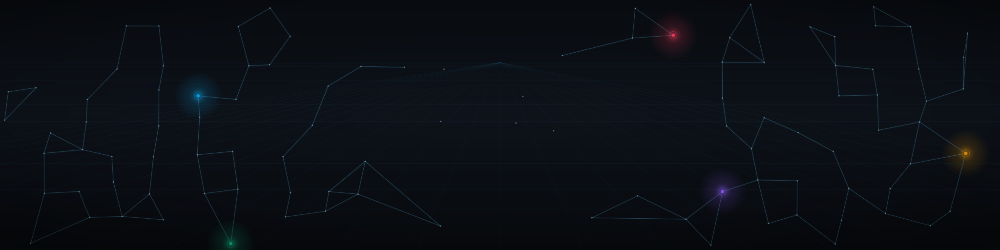

# Susu Protocol

**Non-custodial rotating savings on Stellar**

A *susu* is one of the oldest financial instruments there is: a fixed group pays a fixed amount
into a pool every round, and each round the whole pool goes to one member, until everyone has
been paid exactly once. It works because everyone can see everyone else, and it fails when
someone holds the money.

Susu Protocol keeps the instrument and removes the holder. The pool lives in a Soroban contract
that releases it only to the recipient the schedule names. No operator, no admin key with a
withdrawal function, nothing to run away with.

> **Testnet. Reviewed by the maintainer, not independently audited.** The contract is deployed to
> Stellar Testnet, where the balances are worthless. Mainnet readiness is implemented and
> mechanically verified; the deployment gate is `NO-GO` until the attestations are satisfied.

---

## How a round works

```
   a member            the group contract              the round's recipient
      │                        │                                 │
      │  contribute(exact)     │                                 │
      ├───────────────────────▶│                                 │
      │                        │  rejects a wrong amount,         │
      │                        │  a wrong round, a double pay-in  │
      │                        │                                 │
      │      …every other member contributes…                    │
      │                        │                                 │
      │                        │  once every member has paid in:  │
      │                        ├──── pool − capped fee ──────────▶│
      │                        │                                 │
      │                        │  next round opens, new recipient │
```

A group runs `Draft → Open → Active → Completed`. Members join while it is `Open`; `start` locks
membership once the group is full. After that, joining is refused by the contract, not by a UI
check — see [`docs/CONTRACT_SPEC.md`](https://github.com/susu-labs/susu-contracts/blob/main/docs/CONTRACT_SPEC.md).

## What we build

The chain is the source of truth. Everything else is a convenience layer over it that can be
deleted without moving a single balance.

| Repository | Responsibility | Language | Runs on |
| --- | --- | --- | --- |
| [`susu-contracts`](https://github.com/susu-labs/susu-contracts) | Soroban contracts. **The financial authority.** Holds the funds and the rules. | Rust / Wasm | **Stellar Testnet** |
| [`susu-indexer`](https://github.com/susu-labs/susu-indexer) | Reads chain events and records them in Postgres on a schedule. Reconciled, never trusted. | TypeScript (Deno) | Supabase Cron + Edge Function |
| [`susu-api`](https://github.com/susu-labs/susu-api) | Read model, accounts, invites, notifications, and transaction *preparation*. Cannot move money. | TypeScript (Fastify) | Node |
| [`susu-web`](https://github.com/susu-labs/susu-web) | The client. Builds transactions, asks a wallet to sign, reports what the chain did. | React / Vite | Browser |

### Why four repositories, and not one

The contract is the only component that can move money, and it is the only one with no external
dependencies. Keeping it in its own repository means the thing holding the funds can be reviewed,
frozen at a tag, and audited without a reviewer having to wade through a web app. The other three
can be replaced, rewritten, or switched off without affecting a balance.

## Design rules we hold to

- **No arbitrary withdrawals.** There is no "send to address" entry point anywhere in the
  contracts. Funds leave only to the recipient the round schedule names.
- **Exact amounts, integer arithmetic.** USDC is handled in integer stroops end to end. No floats
  touch money on either side of the wire.
- **Fees are capped in code.** `MAX_FEE_BPS = 50` — half a percent, enforced on-chain, not in a
  config file.
- **Rebuildable from the chain.** Every table the indexer writes can be dropped and re-derived
  from events. Nothing important exists only in a database.
- **The wallet is not trusted.** The client compares what the wallet signed against what it asked
  the wallet to sign, and refuses to submit a substitution.
- **Refusals are values, not exceptions.** A rejected join is a typed contract error, and the UI
  renders it as an explanation rather than as a crash.

## Quick links

| Resource | Link |
| --- | --- |
| Contracts, and the financial invariants | [`susu-contracts`](https://github.com/susu-labs/susu-contracts) |
| Contract interface, method by method | [`docs/CONTRACT_SPEC.md`](https://github.com/susu-labs/susu-contracts/blob/main/docs/CONTRACT_SPEC.md) |
| Threat model and trust boundaries | [`docs/THREAT_MODEL.md`](https://github.com/susu-labs/susu-contracts/blob/main/docs/THREAT_MODEL.md) |
| The reviewer's brief | [`docs/AUDIT_SCOPE.md`](https://github.com/susu-labs/susu-contracts/blob/main/docs/AUDIT_SCOPE.md) |
| Mainnet readiness gate | [`docs/MAINNET_READINESS.md`](https://github.com/susu-labs/susu-contracts/blob/main/docs/MAINNET_READINESS.md) |
| The live Testnet deployment | [`docs/TESTNET.md`](https://github.com/susu-labs/susu-contracts/blob/main/docs/TESTNET.md) |
| How to contribute | [`CONTRIBUTING.md`](https://github.com/susu-labs/susu-contracts/blob/main/CONTRIBUTING.md) |
| Reporting a vulnerability | [`SECURITY.md`](https://github.com/susu-labs/susu-contracts/blob/main/SECURITY.md) |

## Stack

`Stellar / Soroban` · `Rust` · `React` · `TypeScript` · `Fastify` · `Supabase (Postgres, Auth, Storage, Cron)` · `Deno` · `Freighter` · `Tailwind`

## Security posture

The maintainer has reviewed this code; it has **not been independently audited**, and the README of
every repository says so first. What a reviewer would need — scope, assets, trust boundaries, and
the weaknesses we already know about — is written down in [`docs/AUDIT_SCOPE.md`](https://github.com/susu-labs/susu-contracts/blob/main/docs/AUDIT_SCOPE.md)
rather than discovered. The code under review is frozen at the annotated `audit-freeze-1` tag.

Two rules we will not bend:

1. No Mainnet deployment until an independent review is complete and recorded.
2. No Mainnet deployment of an artifact that is not byte-for-byte the audited one.

---

**Built in public. Fork it. Break it. Tell us what you find.**
